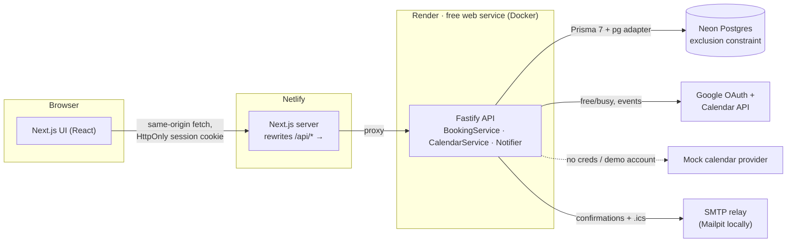
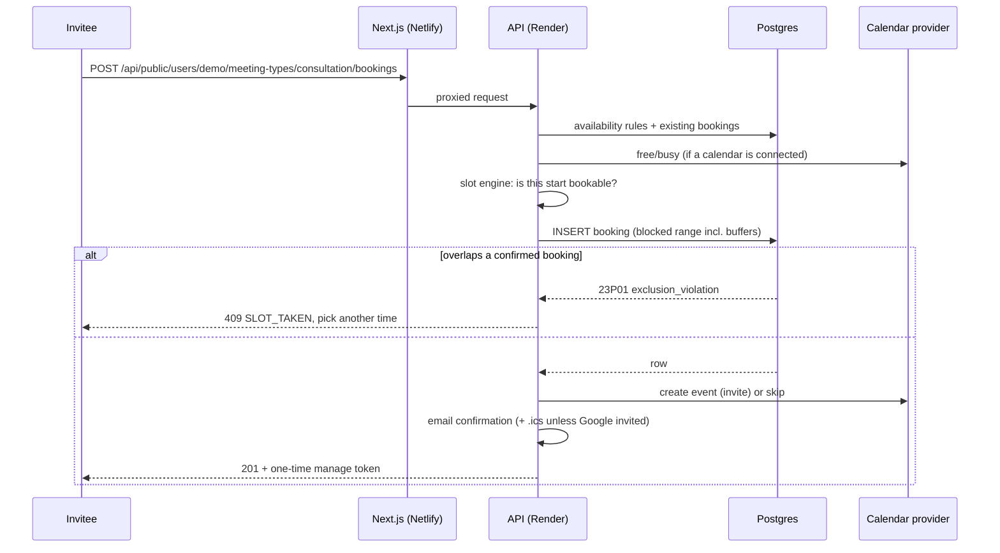

# MeetQueue

[](https://github.com/Isaacpyo/MeetQueue/actions/workflows/ci.yml)

**Live demo: https://meetqueue.temitopeagbola.com** (click **Try the demo**; the first request may
take up to a minute while the free-tier API wakes up)

MeetQueue is a small, fully working scheduling product in the spirit of Calendly. Hosts set their
weekly availability, buffers and meeting types; invitees get a public booking page that shows
open slots in their own timezone; bookings land in the host's Google Calendar (with an `.ics`
email fallback); and invitees can reschedule or cancel from a private link. Double-booking isn't
prevented by app code alone: a **Postgres exclusion constraint** makes overlapping bookings
impossible, even when two people click the same slot at the same moment.

## Features

- **Weekly availability**: several windows per day (e.g. a lunch break), in the host's IANA
  timezone, with daylight-saving changes handled correctly.
- **Meeting types**: duration, buffer before/after, minimum notice, booking horizon, slot interval,
  location, colour, on/off switch. Each type has its own link (`/demo/consultation`).
- **Timezone-aware booking page**: month calendar, timezone switcher, slots grouped by the
  invitee's local date, validated details form, confirmation with **Add to calendar (.ics)**.
- **No double-booking**: `EXCLUDE USING gist (host_id WITH =, tstzrange(blocked_start,
blocked_end) WITH &&) WHERE status = 'CONFIRMED'`, where the blocked range includes buffers.
  An integration test fires 8 concurrent requests at one slot and asserts exactly one wins.
- **Google Calendar via OAuth 2.0**: connect/disconnect, free/busy lookups remove busy times
  from your slots, and events are created, moved and deleted with `sendUpdates=all`. Tokens are
  AES-256-GCM encrypted at rest.
- **ICS email fallback**: confirmation, reschedule (`SEQUENCE` bumped) and cancellation
  (`METHOD:CANCEL`) emails carry a proper `text/calendar` part whenever Google didn't already
  send the invite.
- **Reschedule and cancel links**: unguessable per-booking token (only its SHA-256 is stored),
  redacted from logs and from the host's email log, `Referrer-Policy: no-referrer` on the page.
- **Host dashboard**: upcoming/past/cancelled bookings, host-side cancel, availability editor,
  meeting-type CRUD, integrations status and an email log of everything that was sent.
- **One-click demo**: a seeded host with sample bookings that repairs itself on every demo
  login and can be reset from the dashboard. Visitors' real email addresses are masked there.
- **Free-tier friendly**: a "Waking up the server…" banner appears when Render's sleeping API is
  slow; reads retry through cold starts, and writes run exactly once.
- **Works without any keys**: mock calendar and console email providers kick in automatically.

## Architecture





The browser only ever calls its own origin: Next.js rewrites `/api/*` to the API. That keeps the
session cookie first-party (`HttpOnly`, `SameSite=Lax`, `Secure` in production) and lets Google's
OAuth redirect land on the public domain. The shared `packages/core` holds the slot engine, ICS
writer and zod schemas, so the API and the forms validate with exactly the same rules.

```
apps/web        Next.js 16 App Router UI (Netlify)
apps/api        Fastify 5 + Prisma 7 REST API (Render), migrations, seed, tests
packages/core   Slot engine, ICS builder, zod schemas, DTO types (pure TypeScript)
docs/PLAN.md    Design notes
```

## Stack, and what was swapped or added

| Requested           | Used                                                           |
| ------------------- | -------------------------------------------------------------- |
| Next.js             | Next.js 16 (App Router, React 19, Tailwind CSS 4)              |
| PostgreSQL (Neon)   | PostgreSQL 16 locally / Neon in production                     |
| Prisma              | Prisma 7 with the `pg` driver adapter; raw SQL for constraints |
| Google Calendar API | OAuth 2.0 + Calendar REST v3, plus a mock provider             |

**Swaps (as specified):**

- **Google OAuth app stays in "Testing" mode** with listed test users. Publishing an app that
  uses Calendar scopes requires Google's verification review, which a portfolio project doesn't
  need. Only accounts you add as test users can connect, and Google expires testing-mode refresh
  tokens after 7 days, so reconnecting weekly is expected.
- **Mock calendar provider when there are no credentials** (`CALENDAR_PROVIDER=mock`, or simply no
  `GOOGLE_CLIENT_ID`/`SECRET`). It runs the same connect → callback → create/update/delete path,
  so the app, the demo and the tests work without keys. The shared demo account always uses
  the mock so visitors never attach a real Google account to it.

**Additions (and why):**

- **A separate Fastify API.** The hosting brief puts the backend on Render with a blueprint and a
  waking-server state, so the API is its own service instead of Next.js route handlers. Fastify
  was chosen for its speed, `inject()`-based testing and small footprint.
- **Email via SMTP or console.** The brief asks for an ICS email fallback but names no email
  service. SMTP (nodemailer) works with any free relay (Brevo, Resend SMTP, Gmail app password);
  without `SMTP_URL` emails are logged and visible in the dashboard's email log. docker-compose
  ships Mailpit so you can read the real messages locally.
- **Docker runtime on Render.** The same Dockerfile is used by docker-compose and Render, and it
  runs `prisma migrate deploy` on start (Render's pre-deploy hook isn't available on the free plan).

## Run it locally

### Option A: everything in Docker (one command)

```bash
docker compose up --build
```

| URL                   | What                                               |
| --------------------- | -------------------------------------------------- |
| http://localhost:3000 | Web app (click **Try the demo**)                   |
| http://localhost:4000 | API (`/api/health`)                                |
| http://localhost:8025 | Mailpit: every email sent, with `.ics` attachments |

The API container migrates and seeds the demo host on boot. To try real Google Calendar locally,
export `GOOGLE_CLIENT_ID` and `GOOGLE_CLIENT_SECRET` before `docker compose up` and add
`http://localhost:3000/api/integrations/google/callback` as a redirect URI on the OAuth client.

### Option B: dev servers with hot reload

Requires Node 22 and pnpm 10 (`corepack enable`).

```bash
pnpm install
cp .env.example .env                 # defaults match the compose Postgres below
docker compose up -d db mailpit      # or point DATABASE_URL at your own Postgres 16
pnpm db:migrate && pnpm db:seed
pnpm dev                              # web :3000, API :4000
```

Set `SMTP_URL=smtp://localhost:1025` in `.env` to send emails to Mailpit instead of the console.

### Tests

```bash
pnpm lint          # ESLint (all packages) + Prettier check
pnpm typecheck     # tsc strict, Next.js route types
pnpm test          # unit + API integration tests (needs Postgres; creates TEST_DATABASE_URL's DB)
pnpm test:unit     # unit tests only, no database
pnpm build && pnpm test:e2e   # Playwright smoke test at desktop and 375px widths
```

- `packages/core`: slot engine (buffers, notice, horizon, split days, DST, timezone grouping),
  ICS escaping/folding, schemas.
- `apps/api`: unit tests (crypto, env, error mapping, Google client against a mocked `fetch`,
  privacy masking) and integration tests against real Postgres via `app.inject()`: booking flow,
  the 8-way concurrent race, DB-level constraint checks, reschedule/cancel, OAuth state, demo
  account, authorisation.
- `apps/web`: calendar/format helpers, the API client's retry and waking logic, the banner.
- `apps/web/e2e`: try demo → book on the public page → see it in the dashboard → cancel via the
  manage link.

CI (GitHub Actions) runs install, lint, typecheck and tests on every push and PR, plus the
Playwright suite against built apps and a `docker compose build`.

## Deploy (all free tiers)

### 1. Database: Neon

1. Create a Neon project (Postgres 16) and a database, e.g. `meetqueue`.
2. Copy two connection strings from **Connect**: the **pooled** one (host contains `-pooler`)
   for `DATABASE_URL`, and the **direct** one for `DIRECT_DATABASE_URL`. Keep `?sslmode=require`.
   Migrations enable the `btree_gist` extension, which Neon supports.

### 2. API: Render

1. Render → **New → Blueprint** → select this repo. `render.yaml` creates `meetqueue-api`
   (free plan, Docker, health check `/api/health`).
2. Fill the prompted variables: `DATABASE_URL`, `DIRECT_DATABASE_URL`, and optionally
   `GOOGLE_CLIENT_ID`, `GOOGLE_CLIENT_SECRET`, `SMTP_URL`. `TOKEN_ENCRYPTION_KEY` is generated.
3. Deploy. Migrations run on boot; the demo host is created on the first **Try the demo**.
4. Note the service URL, e.g. `https://meetqueue-api.onrender.com`.

### 3. Google Calendar (optional, otherwise the mock is used)

1. Google Cloud Console → new project → enable the **Google Calendar API**.
2. **OAuth consent screen**: External, publishing status **Testing**; add scopes
   `openid`, `email`, `.../auth/calendar.events`, `.../auth/calendar.freebusy`; add your Google
   account(s) under **Test users**.
3. **Credentials → OAuth client ID → Web application**. Authorised redirect URI:
   `https://meetqueue.temitopeagbola.com/api/integrations/google/callback`
4. Put the client ID/secret on Render and redeploy.

### 4. Email (optional, otherwise emails are only logged)

Any SMTP relay works. For example Brevo's free tier: create an SMTP key, then set
`SMTP_URL=smtp://<login>:<smtp-key>@smtp-relay.brevo.com:587` and an `EMAIL_FROM` on a sender
you've verified there.

### 5. Web: Netlify

The existing Netlify site is already linked to this repo with the custom domain. `netlify.toml`
points it at `apps/web` (base `apps/web`, command `pnpm run build`, publish `.next`); the Next.js
runtime is detected automatically. Add one environment variable and redeploy:

- `API_URL` = your Render URL (e.g. `https://meetqueue-api.onrender.com`)

The build fails fast with a clear message if `API_URL` is missing on Netlify.

## Environment variables

Every variable is listed with comments in [`.env.example`](.env.example).

| Variable                            | Where  | Required | Purpose                                                      |
| ----------------------------------- | ------ | -------- | ------------------------------------------------------------ |
| `DATABASE_URL`                      | API    | yes      | Postgres (Neon pooled URL in production)                     |
| `DIRECT_DATABASE_URL`               | API    | Neon     | Direct URL for `prisma migrate deploy`                       |
| `WEB_ORIGIN`                        | API    | yes      | Public site URL: CORS/origin check, email links, OAuth       |
| `TOKEN_ENCRYPTION_KEY`              | API    | prod     | Encrypts OAuth tokens at rest (any long random string)       |
| `COOKIE_SECURE`                     | API    | no       | Defaults to `true` in production                             |
| `CALENDAR_PROVIDER`                 | API    | no       | `google` or `mock`; auto-detected from credentials           |
| `GOOGLE_CLIENT_ID` / `_SECRET`      | API    | no       | Google OAuth client                                          |
| `GOOGLE_REDIRECT_URI`               | API    | no       | Defaults to `${WEB_ORIGIN}/api/integrations/google/callback` |
| `EMAIL_PROVIDER`                    | API    | no       | `smtp` or `console`; auto-detected from `SMTP_URL`           |
| `SMTP_URL` / `EMAIL_FROM`           | API    | no       | SMTP delivery                                                |
| `DEMO_ENABLED`                      | API    | no       | Enables "Try the demo" (default `true`)                      |
| `RATE_LIMIT_ENABLED`, `TRUST_PROXY` | API    | no       | Defaults `true`                                              |
| `RUN_SEED`                          | Docker | no       | Reset the demo host on every boot                            |
| `PORT`, `HOST`, `LOG_LEVEL`         | API    | no       | Server settings (Render sets `PORT`)                         |
| `TEST_DATABASE_URL`                 | tests  | no       | Database for API integration tests                           |
| `API_URL`                           | Web    | yes      | Where `/api/*` is proxied (read at build time)               |

## Security notes

- Passwords: scrypt with per-user salt; logins for unknown emails still run scrypt (no timing
  oracle). Sessions: random 256-bit token in an `HttpOnly` cookie, stored hashed, 30-day expiry.
- CSRF: `SameSite=Lax` cookies, JSON-only request bodies, and an `Origin` check on every write.
- OAuth: `state` bound to a short-lived cookie; refresh tokens encrypted with AES-256-GCM;
  the shared demo account can't connect a real Google account.
- Manage links: hashed at rest, redacted from request logs and the email log, never sent as a
  `Referer`, `noindex`.
- Input validation with zod at every API boundary (params, query and body), plus DB check
  constraints. Per-route rate limits on auth, booking and manage endpoints.

## Known limitations and tech debt

- Rate limiting is in-memory (fine for one Render instance) and keys on `X-Forwarded-For`, which a
  client can spoof. Use a shared store (e.g. Upstash Redis) before scaling out.
- The public booking form can send email to any address (that's the product), so with SMTP
  enabled it's rate-limited but has no CAPTCHA.
- No email verification or password reset yet; no date-specific availability overrides.
- `WEB_ORIGIN` must match the domain users actually visit; Netlify deploy previews can read but
  writes are rejected by the origin check (and would hit the production API anyway).
- Google testing-mode refresh tokens expire after 7 days; the app falls back to ICS emails and
  logs the failure until the host reconnects.
