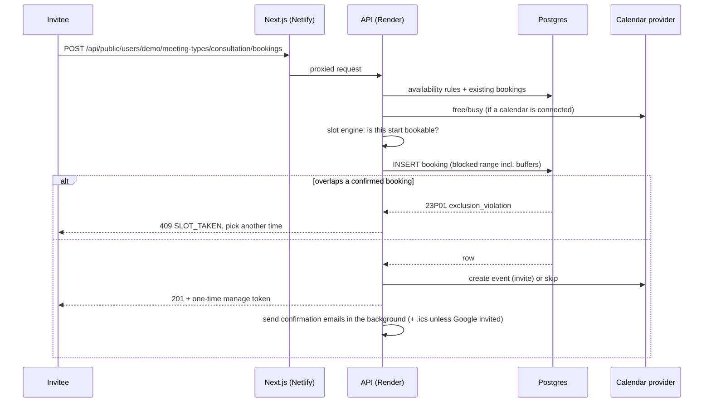

# MeetQueue

[](https://github.com/temitopeagbola/MeetQueue/actions/workflows/ci.yml)

Scheduling and booking for people who take meetings: hosts publish their weekly availability
and meeting types, and invitees book a time on a public page in their own timezone.

Production URL: https://meetqueue.temitopeagbola.com (the Netlify custom domain, also the
`WEB_ORIGIN` in [`render.yaml`](render.yaml)). Its API runs on Render's free tier, which sleeps
when idle, so the first request after a while can take up to a minute.

## Overview

Arranging a meeting usually means a thread of "does Tuesday at 3 work?". MeetQueue replaces that
with a booking link. A host sets the hours they're available (in their own timezone), creates
meeting types with a length, buffers and notice period, and shares the link. Invitees see only
the times that are genuinely free, shown in their timezone, and book in a couple of clicks. The
booking is added to the host's Google Calendar when one is connected (otherwise an `.ics`
invitation is emailed), and the invitee gets a private link to reschedule or cancel.
Double-booking is prevented by the database itself: a Postgres exclusion constraint rejects any
two confirmed bookings for the same host whose time ranges (including buffers) overlap, even
when the requests arrive at the same moment.

## Key features

- **Weekly availability**: several windows per day (e.g. around a lunch break) in the host's IANA
  timezone; slots keep their local wall-clock time across daylight-saving changes.
- **Meeting types**: duration, buffer before/after, minimum notice, how many days ahead people
  can book, spacing between start times, location, colour and an on/off switch. Each type has its
  own URL, e.g. `/demo/consultation`.
- **Public booking page**: month calendar, timezone switcher, times grouped by the invitee's local
  date, a validated details form and a confirmation with **Add to calendar (.ics)**.
- **No double-booking**: the `bookings_no_overlap` exclusion constraint (GiST over
  `host_id` and the blocked time range, confirmed bookings only) rejects overlaps, buffers
  included. Losing a race returns `409 SLOT_TAKEN`.
- **Google Calendar (OAuth 2.0)**: connect/disconnect, free/busy lookups hide times the host is
  busy, and events are created, moved and deleted with invitations (`sendUpdates=all`). OAuth
  tokens are AES-256-GCM encrypted at rest; sync failures show as "Needs attention" on the
  Integrations page.
- **Email and `.ics` invitations**: confirmation, reschedule and cancellation emails to the
  invitee and the host. An `.ics` file (`METHOD:REQUEST` / `CANCEL`) is attached whenever Google
  didn't already send the invite.
- **Reschedule and cancel links**: a private per-booking token (only its SHA-256 is stored),
  redacted from request logs and from the email log.
- **Host dashboard**: upcoming / past / cancelled bookings with host-side cancel, availability
  editor, meeting types, integrations status and an email log of every notification.
- **One-click demo**: "Try the demo" signs into a seeded host with sample bookings. The demo data
  repairs itself on each demo login, can be reset from the dashboard, and masks visitors' real
  email addresses.
- **Waking-server state**: when a request is slow (Render cold start) the UI shows "Waking up the
  server…". Reads retry through the wake-up; writes check the server is up first and are never
  sent twice.
- **Works without keys**: with no Google credentials a mock calendar provider is used, and with
  no SMTP server emails are logged (and still visible in the dashboard) instead of sent.

## Tech stack

| Area           | Technology                                                                     |
| -------------- | ------------------------------------------------------------------------------ |
| Language       | TypeScript (strict), Node.js 22, pnpm workspaces                               |
| Web app        | Next.js 16 (App Router), React 19, Tailwind CSS 4, lucide-react                |
| API            | Fastify 5, zod 4 validation, Luxon (timezones), nodemailer (SMTP)              |
| Database       | PostgreSQL 16 (Neon in production) via Prisma 7 with the `pg` driver adapter   |
| Auth           | Email + password (scrypt), hashed session tokens in an `HttpOnly` cookie       |
| Integrations   | Google OAuth 2.0 + Calendar API v3 (REST); mock provider without credentials   |
| Hosting        | Netlify (web), Render free web service in Docker (API), Neon (Postgres)        |
| Tests and CI   | Vitest, Playwright, GitHub Actions                                             |
| Local services | Docker Compose: Postgres 16, Mailpit (catches outgoing email), API and web app |

**Stack notes:**

- The Google OAuth app is meant to stay in **Testing** mode with listed test users, so no Google
  verification review is needed. Only those accounts can connect a calendar.
- The **mock calendar provider** is selected when `GOOGLE_CLIENT_ID`/`GOOGLE_CLIENT_SECRET` are
  missing or `CALENDAR_PROVIDER=mock`. It follows the same connect → callback → create / update /
  delete path. The shared demo account always uses it, so visitors never attach a real Google
  account to it.
- The API is a separate Fastify service (not Next.js route handlers) so it can run on Render,
  and email goes through any SMTP relay or the console.

## Architecture




- The browser only calls its own origin. Next.js rewrites `/api/*` to the API (`API_URL`, read at
  build time), so the session cookie is first-party (`SameSite=Lax`, `Secure` in production) and
  Google's OAuth redirect lands on the public domain.
- `packages/core` is shared by both apps: the slot engine, the `.ics` writer, zod schemas and the
  JSON types, so the API and the forms validate with the same rules.
- **API routes** (all under `/api`): `health`, `auth` (signup, login, logout, me, demo, demo reset),
  `availability`, `meeting-types`, `bookings` (host list + cancel), `integrations` (Google connect /
  callback / disconnect), `emails`, `public/users/:username/...` (profile, meeting type, slots,
  create booking) and `manage/:token` (view, slots, reschedule, cancel, `.ics`).
- **Database tables**: `users`, `sessions`, `availability_rules`, `meeting_types`, `bookings`,
  `calendar_connections`, `email_logs`. Besides foreign keys, the migrations add the
  `bookings_no_overlap` exclusion constraint and check constraints on booking times,
  availability rules and meeting-type settings.

## Project structure

| Path                 | What it holds                                                                                   |
| -------------------- | ----------------------------------------------------------------------------------------------- |
| `apps/web/`          | Next.js app: landing, auth, dashboard, public booking and manage pages; e2e tests               |
| `apps/api/`          | Fastify API: routes, services, calendar/email providers, Prisma schema, migrations, seed, tests |
| `packages/core/`     | Shared slot engine, ICS builder, zod schemas and DTO types                                      |
| `docs/PLAN.md`       | Design notes                                                                                    |
| `.github/workflows/` | CI pipeline                                                                                     |
| `docker-compose.yml` | Whole system locally: Postgres, Mailpit, API, web                                               |
| `render.yaml`        | Render Blueprint for the API                                                                    |
| `netlify.toml`       | Netlify build settings for `apps/web`                                                           |
| `.env.example`       | Every environment variable, with comments                                                       |
| `AGENTS.md`          | Instructions for coding agents (`CLAUDE.md` imports it)                                         |

## Getting started

### Prerequisites

- **Node.js 22** or newer (`.nvmrc`, `engines`)
- **pnpm 10.28.0** (pinned in `packageManager`; `corepack enable` installs it)
- **Docker** with Compose, for the local Postgres 16 and Mailpit (or bring your own Postgres 16;
  the migrations enable the `btree_gist` extension)

### Option A: everything in Docker

```bash
docker compose up --build
```

| URL                   | What                                               |
| --------------------- | -------------------------------------------------- |
| http://localhost:3000 | Web app (click **Try the demo**)                   |
| http://localhost:4000 | API (`/api/health`)                                |
| http://localhost:8025 | Mailpit: every email sent, with `.ics` attachments |

The API container applies migrations and seeds the demo host on start. To use real Google
Calendar locally, export `GOOGLE_CLIENT_ID` and `GOOGLE_CLIENT_SECRET` before
`docker compose up`, and add `http://localhost:3000/api/integrations/google/callback` as a
redirect URI on the OAuth client.

### Option B: dev servers with hot reload

```bash
pnpm install
cp .env.example .env.local           # gitignored; defaults match the compose Postgres
docker compose up -d db mailpit      # or point DATABASE_URL at your own Postgres 16
pnpm db:migrate && pnpm db:seed
pnpm dev                             # web on :3000, API on :4000
```

The API reads `apps/api/.env.local`, `apps/api/.env`, then the repo-root `.env.local` and `.env`
(the first file that sets a variable wins). Set `SMTP_URL` to `smtp://localhost:1025` in
`.env.local` to send email to Mailpit instead of the console.

### Environment variables

Names only; see [`.env.example`](.env.example) for defaults and comments. Never commit real
values: `.env` and `.env.local` are gitignored.

| Variable               | Used by | Purpose                                                                   |
| ---------------------- | ------- | ------------------------------------------------------------------------- |
| `DATABASE_URL`         | API     | Postgres connection used at runtime (Neon: the pooled URL)                |
| `DIRECT_DATABASE_URL`  | API     | Optional non-pooled connection for `prisma migrate deploy` (Neon: direct) |
| `TEST_DATABASE_URL`    | Tests   | Database for API integration tests (created and migrated automatically)   |
| `PORT`, `HOST`         | API     | Listen address (Render sets `PORT`)                                       |
| `WEB_ORIGIN`           | API     | Public web URL: CORS and origin check, links in emails, OAuth redirect    |
| `COOKIE_SECURE`        | API     | Mark cookies `Secure` (on by default in production)                       |
| `TRUST_PROXY`          | API     | Trust `X-Forwarded-For` from the proxy in front                           |
| `TOKEN_ENCRYPTION_KEY` | API     | Secret for encrypting OAuth tokens; required in production with Google    |
| `LOG_LEVEL`            | API     | Log verbosity                                                             |
| `CALENDAR_PROVIDER`    | API     | `google` or `mock`; auto-detected from the Google credentials             |
| `GOOGLE_CLIENT_ID`     | API     | Google OAuth client ID                                                    |
| `GOOGLE_CLIENT_SECRET` | API     | Google OAuth client secret                                                |
| `GOOGLE_REDIRECT_URI`  | API     | Override for the OAuth callback URL                                       |
| `EMAIL_PROVIDER`       | API     | `smtp` or `console`; auto-detected from `SMTP_URL`                        |
| `SMTP_URL`             | API     | SMTP server for real email delivery                                       |
| `EMAIL_FROM`           | API     | Sender address                                                            |
| `DEMO_ENABLED`         | API     | Enables the shared demo account and "Try the demo"                        |
| `RATE_LIMIT_ENABLED`   | API     | In-memory rate limiting                                                   |
| `RUN_SEED`             | Docker  | Reseed the demo host when the API container starts                        |
| `API_URL`              | Web     | Where Next.js proxies `/api/*` (read at build time)                       |

## Scripts

Run from the repo root.

| Command                                                   | What it does                                                                 |
| --------------------------------------------------------- | ---------------------------------------------------------------------------- |
| `pnpm dev`                                                | API (`tsx watch`) and web (`next dev`) together                              |
| `pnpm build`                                              | Builds the API bundle and the Next.js app                                    |
| `pnpm lint`                                               | ESLint in every package, then a Prettier check                               |
| `pnpm format`                                             | Formats the repo with Prettier                                               |
| `pnpm typecheck`                                          | `tsc --noEmit` everywhere (plus Next.js route types)                         |
| `pnpm test`                                               | Unit and integration tests in every package                                  |
| `pnpm test:unit`                                          | Unit tests only (no database needed)                                         |
| `pnpm test:e2e`                                           | Playwright smoke test (run `pnpm build` first)                               |
| `pnpm db:migrate`                                         | Applies pending migrations (`prisma migrate deploy`)                         |
| `pnpm db:seed`                                            | Creates or resets the demo host and its sample data                          |
| `pnpm --filter @meetqueue/api db:migrate --name <change>` | Creates a new migration after editing `schema.prisma` (`prisma migrate dev`) |

## Testing

```bash
pnpm test:unit                 # unit tests, no database
pnpm test                      # unit + API integration tests (needs Postgres)
pnpm build && pnpm test:e2e    # Playwright, desktop and 375px wide
```

- **Unit** (Vitest): the slot engine (buffers, notice, horizon, split days, DST, timezone
  grouping), `.ics` escaping and folding, schemas, crypto, env parsing, error mapping, the Google
  client against a mocked `fetch`, login throttling, and the web app's date helpers, API client
  retry/waking logic and banner.
- **Integration** (Vitest + real Postgres via Fastify `inject()`): the booking flow, eight
  concurrent requests for one slot (exactly one wins), database-level constraint checks,
  reschedule and cancel, OAuth state checks, the demo account, authorisation between hosts and
  slow-email handling. `TEST_DATABASE_URL` defaults to a `meetqueue_test` database on the compose
  Postgres, which the test setup creates and migrates.
- **End-to-end** (Playwright): try the demo → book on the public page → see it in the dashboard
  → cancel through the manage link. It starts the built API and web app itself, or reuses ones
  already running on ports 4000 and 3000.

**CI** ([`.github/workflows/ci.yml`](.github/workflows/ci.yml)) runs on every push and pull
request: install, lint, typecheck and unit + integration tests against a Postgres service; the
Playwright test against built apps; and `docker compose build`.

## Deployment

All three services have free tiers.

1. **Database (Neon)**: create a Postgres 16 project and database. Use the **pooled** connection
   string as `DATABASE_URL` and the **direct** one as `DIRECT_DATABASE_URL` (keep
   `sslmode=require`).
2. **API (Render)**: New → Blueprint → this repo. [`render.yaml`](render.yaml) defines
   `meetqueue-api` (free plan, Docker, region Frankfurt, health check `/api/health`). Enter the
   prompted variables (`DATABASE_URL`, `DIRECT_DATABASE_URL`, and optionally the Google and SMTP
   ones); `TOKEN_ENCRYPTION_KEY` is generated. The container applies migrations on start. The
   demo host is created on the first "Try the demo".
3. **Google Calendar (optional)**: in Google Cloud, enable the Calendar API, keep the OAuth
   consent screen in **Testing** with your account as a test user, add the scopes `openid`,
   `email`, `calendar.events` and `calendar.freebusy`, and create a Web OAuth client with the
   redirect URI `https://meetqueue.temitopeagbola.com/api/integrations/google/callback`. Put the
   client ID and secret on Render.
4. **Email (optional)**: set `SMTP_URL` and `EMAIL_FROM` on Render for any SMTP relay.
5. **Web (Netlify)**: [`netlify.toml`](netlify.toml) builds `apps/web` (`pnpm run build`,
   publish `.next`). Set `API_URL` to the Render service URL in the site's environment variables
   and redeploy; the build stops with a clear error if it's missing. Netlify installs
   dependencies in the base directory and only chooses pnpm when it finds a lockfile there, so
   `apps/web/pnpm-lock.yaml` is a symlink to the root lockfile. If that ever fails, the
   documented alternative is to remove `base`, move `netlify.toml` into `apps/web/` and set
   **Package directory** to `apps/web` in the site's build settings.

Pushing to `main` deploys the web app on Netlify and, with `autoDeploy` in `render.yaml`, the API
on Render.

## Security notes

- Passwords are hashed with scrypt, and failed logins for unknown emails take as long as real
  ones. After 10 failed sign-ins within 15 minutes, the account is locked until that window
  ends. Sessions are random 256-bit tokens, stored hashed, valid for 30 days.
- CSRF: `SameSite=Lax` cookies, JSON-only request bodies and an `Origin` check on every write.
- OAuth `state` is bound to a short-lived cookie. The demo account's username and email are
  reserved so no one can register them.
- Manage links are hashed at rest, redacted from logs and the email log, never sent as a
  `Referer` and marked `noindex`.
- Every API input (params, query, body) is validated with zod, and auth, booking and manage
  endpoints are rate-limited per client IP (Netlify's `x-nf-client-connection-ip`).

## Known limitations

- Rate limiting is in-memory (one Render instance). The client-IP header is only trustworthy
  behind Netlify; direct calls to the Render URL can forge it.
- The booking form emails whatever address an invitee enters; it's rate-limited but has no
  CAPTCHA.
- No email verification, password reset or date-specific availability overrides yet.
- `WEB_ORIGIN` must match the domain people use; writes from other origins (e.g. Netlify deploy
  previews) are rejected.
- Refresh tokens for a Google OAuth app in Testing mode expire after 7 days, so hosts need to
  reconnect weekly. Until they do, bookings still work with `.ics` emails.

## Contributing

1. Create a branch from `main` (`feat/…`, `fix/…`, `chore/…`).
2. Make the change with tests, then run `pnpm lint`, `pnpm typecheck` and `pnpm test`.
3. Open a pull request against `main`; CI must pass before merging.

Coding agents follow [`AGENTS.md`](AGENTS.md).

## License

All rights reserved.
